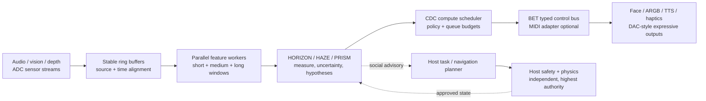

# SOMA CODEC / BET — ADC, DAC, MIDI & CDC Buffer Atlas v0.1

**Status:** Experimental systems-design visual atlas; not a validated hardware specification. November 2026.

This catalog expands the preceding **SOMA HORIZON Systems Atlas** and **BET Module Form Factor Atlas** into the communication and timing interface between *what is measured* and *how a robot conveys a response*. Concept renders are illustrative. Tables and timing equations below are intended to be technically readable and testable.

## Atlas plates

### Plate 01 — Mountable BET module and signal pathways


**How:** Multimodal sensors and onboard/host context produce digital observations; HORIZON/PRISM/HAZE infer alternatives; CDC selects a compute and expression profile; a MIDI-inspired control bus instructs expression drivers. **What:** A transport-independent advisory interface with versioned messages. **Why:** An independently developed robot chassis can keep its locomotion, collision and navigation responsibilities while BET coordinates voice, lights, face and conversational timing.

### Plate 02 — Advisory separation and control plane


**How:** Raw sensor streams feed feature extraction, evidence association and contextual inference; controlled parameters are published downstream. **What:** High-bandwidth PCM/video on their native channels; compact parameter and discrete-event messages on an expression-control channel. **Why:** Fast acknowledgments need not wait for language-model planning or synthesis. *This is a conceptual hardware illustration, not a bill of materials.*

### Plate 03 — ADC capture and concurrent prosody-analysis windows


**How:** Capture microphone PCM with timestamps, preserve a ring buffer, then feed *independent overlapping analysis windows*. The audio-device callback size, analysis window length and hop size are distinct settings. **What:** Voice activity, onset timing, RMS level, spectral envelope, estimated pitch contour, cadence and ASR transcripts, each with source association and validity. **Why:** Responsive interruption handling uses short windows while low-frequency pitch and timbral analysis may need longer evidence.

| Frame size (samples) | At 44.1 kHz | At 48 kHz | FFT bin spacing at 48 kHz |
|---|---:|---:|---:|
| 256 | 5.80 ms | 5.33 ms | 187.5 Hz |
| 512 | 11.61 ms | 10.67 ms | 93.75 Hz |
| 1,024 | 23.22 ms | 21.33 ms | 46.875 Hz |
| 2,048 | 46.44 ms | 42.67 ms | 23.4375 Hz |

`frame_duration_ms = 1000 * samples / sample_rate_hz`; `FFT_bin_spacing_hz = sample_rate_hz / FFT_size`.

**Important:** FFT bin spacing is **not** directly the accuracy of an F0/pitch tracker. A low-pitched voice can require several waveform periods; the short onset detector must not substitute for pitch tracking. These frame durations are not total ADC-to-response latency; device drivers, lookahead, processing, queueing, LLM/ASR/TTS and output buffering also contribute. Overlap permits fast *updates* without shortening the evidence window.

### Plate 04 — MIDI-inspired control bus and expressive DAC


**How:** Publish timestamped parameters with stable semantic IDs, event types, limits, output-specific targets and expiration rules. An optional adapter maps them to actual MIDI messages or to a native typed API. **What:** `BET.VOICE.RATE`, `BET.VOICE.ENERGY`, `BET.FACE.ATTENTION`, `BET.LIGHT.BRIGHTNESS`, `BET.MODE.PROFILE`, plus discrete events such as `START_LISTENING`, `ACKNOWLEDGE_TURN`, `END_TURN`. **Why:** Changes in inferred communication context can coordinate several DAC outputs through a common control language rather than hard-coding each robot's embodiment.

- **MIDI 1.0:** Standard Control Change generally carries 7-bit values (0–127); some defined MSB/LSB controller pairs provide 14-bit combined values. Some CC numbers are already standardized (e.g., CC7 = channel volume; CC11 = expression); **do not overwrite these meanings in a public MIDI interface** without negotiated mapping. Historic ACCORD MIDI CC assignments contain collisions and require consolidation before interoperability.
- **MIDI 2.0:** Control Change over Universal MIDI Packet supports 32-bit values; adoption still requires device/library negotiation.
- **BET internal bus:** Keep higher-precision normalized values, enums and explicit message metadata; only quantize at the edge when exporting to a particular MIDI adapter. MIDI carries *control*, not raw speech audio.
- **DAC here means expressive output as an architectural category**, including native digital displays, TTS/audio playback, ARGB LEDs, and permitted haptics; physical audio output passes through an actual DAC, while LEDs and displays use their corresponding drivers.

#### Proposed control packet (illustrative schema)

```json
{
  "schema": "bet.control.v0.1",
  "timestamp_ms": 123456,
  "source_agent": "robot_R",
  "source_event_id": "evt_402",
  "parameter": "BET.FACE.ATTENTION",
  "value": 0.72,
  "quality": 0.84,
  "valid": true,
  "ttl_ms": 300,
  "recipient": "robot_R.face_display",
  "reason": "current speaker acknowledged"
}
```

The example is not a measured value or a standardized MIDI packet. Bound the value, validate sender/recipient, expire stale messages and smooth output transitions. Never use this expression bus to authorize motor torque or bypass collision safeguards.

### Plate 05 — CDC modes, buffer tiers and protocol density


**How:** Independently configure: **(a)** BET hardware/capability tier, **(b)** CDC situational operating mode, and **(c)** analysis window sizes; additionally vary publish frequency, active channels, history depth and reasoning complexity. **What:** The scheduler makes deliberate resource tradeoffs without treating social stimuli as automatically dangerous. **Why:** A dense/noisy environment should allocate resources according to attention and tasks, not necessarily max out every sensor and LLM.

| Separate axis | Definition | Example configuration |
|---|---|---|
| BET tier **T0–T4** | What sensors/outputs and interaction capabilities are supported | Passive capture → expressive cueing → interactive co-presence → social navigation → adaptive collaboration |
| CDC modes **0–5** | Which context slice, checking policy and computational budget apply right now | Idle / Standard / Cooperative / Alert / Sovereignty Defense / Emergency (historical draft names) |
| Audio analysis | Audio callback, frame window and hop are separate | Stable 48 kHz capture; parallel 256, 512, 1024 and 2048 sample windows |
| Protocol density | Features × update frequency × evidence history × inference depth | Sparse presence notices → normal prosody/gesture → multi-hypothesis analysis |

**Mode-label hygiene:** CDC mode `4` appears as *Sovereignty Defense* in `CDC_MODE_SWITCHING_ARCHITECTURE_v0.1.md`; the graphic abbreviates the integrity-check intent to **DEFENSE**. This is a *social advisory/security logic mode*, not a bypass of host safety. In an emergency, the host independently handles collision/braking; the BET module reduces nonessential inference.

**Do not directly bind an emergency mode to a smaller physical audio buffer or to an LLM response.** Reconfiguring a device stream can cause dropouts. Keep stable acquisition where practical, use overlapping frame windows, drop superseded inference jobs, coalesce repetitive CC-like output changes and enforce per-lane deadline/TTL policies. The original documents' sub-millisecond or fixed update-rate statements are hypothetical targets, not proven on deployed hardware.

### Plate 06 — Expo scene: parallel response lanes


**How:** Robot R listens to Person X, intermittently sees Visitor Y waiting, and separately tracks a loud demonstration by Exhibitor Z. A fast event lane may produce a nonverbal *listening acknowledgment* while source association, PRISM hypotheses, language decisions and TTS proceed. **What:** Separate tracks for audio onset, who-spoke estimation, possible visual conversational bid, interpretation alternatives and outward gestures/voice. **Why:** Timing can feel more natural without faking certainty or using an LLM in a hard real-time loop.

The timeline uses **relative units**, not real latency claims. The system does **not** infer hostility from loudness or infer sincerity from congruent body language. A greeting or visual acknowledgment is a socially contingent choice; do not engage people persistently just because they appear nearby.

## Core design rule: four separate loops



A literal ADC belongs in the microphone/camera electronics. A literal audio DAC belongs in playback hardware. The schematic also uses **ADC/DAC metaphorically** for the overall multi-modal sensory input and expressive output paths, following the BET architecture's vocabulary.

## Engineering prototype and measurement checklist

1. Capture native-rate audio using a stable ring buffer; derive parallel overlapping windows without reinitializing the device at every CDC transition.
2. Implement VAD/onset, energy, pitch candidates and source attribution as separately timed components; supply source ID, timestamp, valid/unknown, quality and provenance.
3. Implement a versioned BET parameter dictionary, event registry, transport adapter, TTL, bounds and driver-specific smoothing; resolve legacy CC assignment collisions.
4. Give LCD/ARGB a fast bounded cue lane independent from ASR/LLM/TTS; record whether early cues are useful or merely distracting.
5. Test idle, dialogue, playful noise, multiple speakers, occlusion, device dropout and emergency motor-stop in **isolated** scenarios; never let the BET advisory block the safety controller.
6. Log callback underruns, frame/hop timing, source attribution error, queue delay, percentile feature latency, TTS first-audio time, dropped/stale commands, CPU/GPU load and perceived interaction quality. Replace all guesswork with measured data.
7. Compare control A: fixed feature schedule; B: CDC schedule; C: CDC + multi-window prosody; D: CDC + early nonverbal cue. Measure cost as well as behavior.

## Provenance and research limitations

**Grounded in supplied research drafts:** `BUFFER_LATENCY_REFERENCE.md`, `BET Module — Concept Note v0.1.md`, `CDC_MODE_SWITCHING_ARCHITECTURE_v0.1.md`, `BET_LEXICON_v0.1.md`, earlier SOMA HORIZON / BET atlas concepts. These documents contain early hypotheses and unverified latency and interaction-performance claims.

**Outside technical references:**
- MIDI Association, *MIDI 1.0 Control Change Messages*: https://midi.org/midi-1-0-control-change-messages
- Universal MIDI Packet / MIDI 2.0 Protocol specification (M2-104-UM): https://amei.or.jp/midistandardcommittee/MIDI2.0/MIDI2.0-DOCS/M2-104-UM_v1-0_UMP_and_MIDI_2-0_Protocol_Specification.pdf
- PortAudio, *Buffering, Latency and Timing Implementation Guidelines*: https://github.com/PortAudio/portaudio/wiki/BufferingLatencyAndTimingImplementationGuidelines

The visual figures are **conceptual research illustrations**. They are not test results, verified real-time performance, product hardware specifications, validated emotion inference or evidence that a behavior will improve human well-being.
