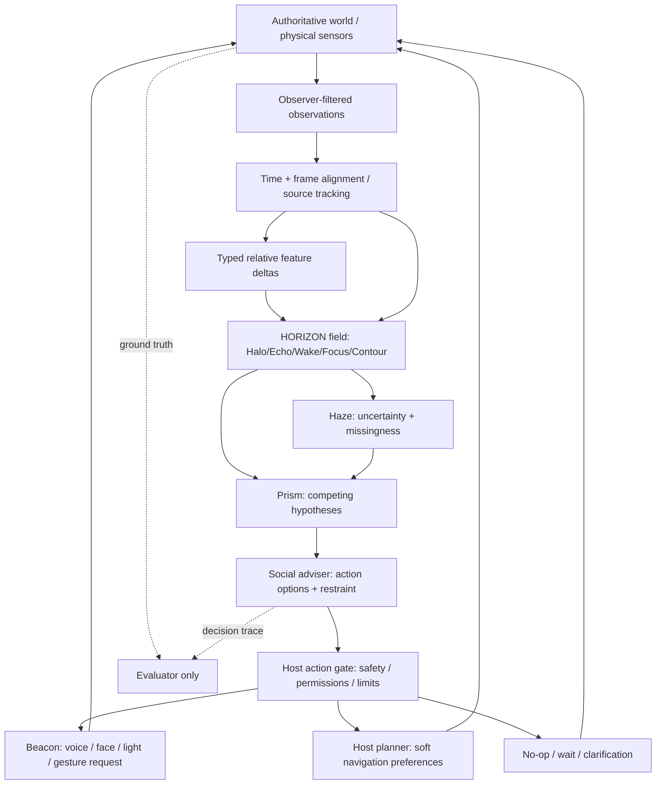

# SOMA HORIZON ΔP — Mathematical & Control Addendum v0.2

**Date:** 31 October 2026  
**Status:** Proposed engineering reconciliation; testable hypotheses, not empirically validated affect or social-control formulas.  
**Companion documents:** `SOMA_HORIZON_DeltaP_Concept_Spec_v0.1.md`; `SOMA_RANGE_Master_Build_Blueprint_v1.0.md`; `CDC_MODE_SWITCHING_ARCHITECTURE_v0.1.md`; `SOMA Codec — Chatbot Tier Expression Spec v0.5.md`.  
**Purpose:** Refine locally proposed ΔP, coherence, damping, CDC, social costmap, and humor-controller equations into implementation-safe hypotheses with explicit falsification tests.

## 0. Decision summary and normative precedence

- **KEEP / IMPLEMENT:** context-relative typed sensory deviations, sensor/source provenance, spatial uncertainty, separate compute profiles, spatially anisotropic social *advisories*, smoothing and hysteresis.
- **REFINE / EXPERIMENT:** multi-channel salience score, cross-modal consistency, socially weighted path costs, bounded register adaptation, contextual humor selection.
- **DO NOT SHIP AS FACT:** sincerity from visual/vocal congruence; aggression from loudness; hostility = large deviation; humor as a universal calming actuator; calibrated emotional-pressure scores without evidence; social PID to directly regulate another person's unobservable emotional state.
- **SAFETY RULE:** chassis/host independently governs collision, speed, authorization and emergency stopping. Social preference cannot reduce these protections, including in an emergency.
- **PROVENANCE:** simulation-authored NPC intentions are evaluator ground truth only, never automatic robot observations.

## 1. Architecture — distinct measurement, inference and control



**Normative clarification:** The language model may select among permitted social options but cannot bypass permission, safety, audience, or action-schema gates. A direct Director edit is a logged privileged intervention, not ambient evidence. The social adviser does not own robot torques or collision safety.

## 2. ΔP — typed per-channel deviations (implement first)

For an observed numeric feature channel `k` associated with source track `i`, in context `c`:

\[
 z_{i,k}(t)=\operatorname{clip}\left(\frac{x_{i,k}(t)-b_{i,k}(c,t)}{\max(s_{i,k}(c,t),\epsilon)},-M_k,M_k\right).
\]

- `x`: timestamped, source-associated measurement with units and confidence/provenance.
- `b`: explicit baseline scope (`ENVIRONMENT`, `SESSION`, or consented and adequately observed `SOURCE`). No invented per-person history.
- `s`: robust scale (e.g., 1.4826 × median absolute deviation after enough observations) or declared engineering fallback in same units, with positive floor `ε`.
- `M`: declared channel-specific outlier clip, **not** necessarily a universal social-intensity threshold.
- `q ∈ [0,1]`: observation quality, **separate** from `z`; must not be multiplied in a way that renders missing observations neutral.
- `validity`: `OBSERVED | DEGRADED | OCCLUDED | MISSING | EXPIRED | UNKNOWN_SOURCE`.
- If missing or uncalibrated and no legitimate fallback exists, `z = null`, not 0. A categorical event (raised hand, yielded turn) stays categorical.
- Record both sensor frame and robot-local/world transformations and timestamps; confidence does not imply truthfulness.

**Baseline update rule (starting hypothesis):** use bounded rolling robust statistics; slow or freeze updates during tracked anomalies and after major context changes. Record algorithm version. Baseline learning is session-scoped by default in public settings.

## 3. Derived salience: optional summary, never a universal emotional pressure

With valid numeric channels `V`, channel weights `w_k ≥ 0`, and reliability `q_k`:

\[
 S_i(t)=\sqrt{\frac{\sum_{k\in V} w_kq_k\,\rho(z_{i,k})^2}{\sum_{k\in V}w_kq_k}}, \qquad
 Q_i(t)=\frac{\sum_{k\in V}w_kq_k}{\sum_{k\in K}w_k}.
\]

- `ρ` can be identity after clipping; robust Huber-like transforms can be evaluated later.
- If denominator is 0, `S = null` and `Q = 0`.
- `S` is an **experimental relative feature-activity / attention candidate** score; it has no default valence, hostility, urgency, danger or sincerity interpretation.
- `Q` reports fraction/quality of expected evidence channels. High `S`, low `Q` = conspicuous but poorly observed, not reliable certainty.
- Keep the full signed channel vector and event flags; never make a critical decision using `S` alone.
- Document a versioned feature configuration; do not compare `S` across configurations with different channel sets without normalization/recalibration.

**Synthetic arithmetic check:** `z_audio=+2`, `q_audio=.9`, `z_gesture=+1`, `q_gesture=.8`, equal weights → `S = sqrt((.9×4+.8×1)/1.7) ≈ 1.609`; if a third expected equal-weight channel is missing, `Q = 1.7/3 ≈ .567`. This is NOT an emotional classification.

## 4. Source position and multimodal association

**Reject:** `Direction = Centroid(AudioSource, VisualSource)` as a general localization rule. Audio may supply only bearing, vision may provide uncertain 3D position, and modalities may refer to different people or a reflected speaker.

Maintain per-track `TrackHypothesis` objects with:

```yaml
track_id: ephemeral_04
observed_at_s: 41.20
frame: robot_local
position_m: {x: 1.2, y: -0.4, z: 0.0}  # only when range is supported
bearing_deg: 27.0
range_status: ESTIMATED             # or UNKNOWN
position_covariance: provisional   # covariance when available
source_candidates:
  - {kind: visible_person, track: ephemeral_04, evidence: [mouth_motion, onset_alignment]}
  - {kind: PA_reflection, track: null, evidence: [reverb_delay]}
association: HELD_OPEN
expires_at_s: 42.20
```

Use time alignment, calibrated extrinsics, microphone localization, visual motion, source-separation evidence and ambiguity management. Preserve multiple hypotheses or abstain; do not average incompatible tracks into a fictitious person.

## 5. Coherence ≠ sincerity

**Do not implement:** `χ = Correlation(verbal, prosodic, kinesic)` as a truthfulness score. The three variables lack a common semantic axis and three disparate channels alone do not define a meaningful correlation statistic.

Implement instead three separate, explicitly operational metrics:

1. `association_consistency`: evidence that particular audio and visual events share a source (e.g., synchronized voice onset / mouth movement with correct delay).
2. `temporal_consistency`: whether cues occur within calibrated synchronization windows.
3. `hypothesis_support`: evidence for competing explanations of *the situation* (e.g., `PLAYFUL_PERFORMANCE`, `POSSIBLE_TURN_BID`, `OTHER_CONVERSATION`, `UNKNOWN`). Keep source evidence and counter-evidence; initial labels `COMMIT`, `LEAN`, `HELD_OPEN` rather than uncalibrated numerical posterior probabilities.

A mismatch may be sarcasm, theatrical performance, disability, sensor error, noise, cultural difference, or an unknown. No inference of deception, danger, criminality, mental health or moral worth from cross-modal mismatch.

## 6. CDC — mode selection for compute quality of service, not physical safety

The original CDC Mode Switching documentation defines six templates (0 IDLE, 1 STANDARD, 2 COOPERATIVE, 3 ALERT, 4 SOVEREIGNTY, 5 EMERGENCY). Preserve this vocabulary for compatibility but separate three distinct clocks:

| Loop | Example prototyping policy | Runs where | Authority |
| --- | --- | --- | --- |
| Host collision/safety | Engine physics tick or real host deterministic loop; verified on target | Godot/robot host | Hard, independent |
| Feature tracking and temporal fusion | 5–20 Hz or event-driven; tune with profiling | HORIZON adapter | Observation only |
| LLM planning and dialogue | Event-triggered; measured latency can be hundreds of ms or seconds | Inference service | Proposal only |

A source spec's `<1 ms` interrupt and `1 kHz` host motor loop are **not general guarantees**. Those figures require hardware, controller and end-to-end profiling. A MIDI/CC-like parameter profile is an *interface/configuration abstraction*, not proof of instant hardware-level reconfiguration. Switching a template must not defer physical collision handling.

**Proposed CDC states for RANGE beta:** `IDLE`, `STANDARD`, `FOCUSED`, `ALERT_CONTEXT`, `EMERGENCY_HOST_ONLY`. Keep mapping table to historic 0–5 templates, but do not infer urgency or an adversarial condition from raw behavioral intensity. `ALERT_CONTEXT` prioritizes salient/uncertain observation processing; only host-grounded physical hazards trigger physical safety reflexes. Separate compute QoS changes from social response style.

**Anti-flap logic:** Use entry threshold `T_on > T_off` exit threshold, minimum dwell duration `d`, and cooldown for noncritical mode changes; emergency host safety never waits for social hysteresis. All values are tunable test parameters, not universal empirical thresholds.

## 7. Damping = robot output stabilization, not subtraction from another mind

**Reject as a direct control law:**

\[
\Delta P_{human,k}^{new}=\Delta P_{human,k}-\zeta\,DAC_{robot,k}(t-\tau).
\]

It subtracts incompatible observables, assumes linear predictable effects on another person, and can create false control claims.

**Implement** a rate-limited output state, for physical expression channels controlled by the robot:

\[
 u_t=\operatorname{clip}_{physical}\!\left[u_{t-1}+\operatorname{clip}(u^{target}_t-u_{t-1},-r\Delta t,r\Delta t)\right].
\]

For a soft-social-advisory envelope, an optional low-pass filter:

\[
 a_t=\alpha a_{t-1}+(1-\alpha)a_t^{raw},\quad\alpha=e^{-\Delta t/\tau}.
\]

Interpret `u` as *robot-controlled* output parameters (voice loudness or speech-rate target, gesture amplitude, display transitions), not human emotion. Speech changes should be applied at utterance boundaries when abrupt modification would impair intelligibility; head and arm motion obey host kinetic limits. Use source timestamps and discard expired advisories.

**Behavioral policy:** Adapt conversational tempo/register within permission and context. Never automatically apply `u_robot = -ΔP_human`. A calm response is not universally effective; sometimes matching an energetic person's brevity or playfulness is more appropriate. Test with reversible, low-risk choices.

## 8. Social costmap — strong candidate, with hard/soft separation

For person/track `i`, position `p_i`, anisotropic orientation covariance `Σ_i` (positive definite), and selected context weight `a_i ≥ 0`:

\[
 C_i(x)=a_i\exp\!\left[-\tfrac12(x-p_i)^T\Sigma_i^{-1}(x-p_i)\right].
\]

\[
 C_{social}(x)=\operatorname{clip}\!\left(\sum_i C_i(x)+C_{group}(x),0,C_{soft,max}\right).
\]

A rotated covariance allows different longitudinal/lateral spread; a front/back split field can be added when justified by actual motion and turn-taking. `C_group` can represent the space between conversational participants or queues. These are **soft navigation preferences**, not safety classifications. `a_i` depends on geometry, probable trajectory, conversational context and uncertainty—not on a supposed hostility score or loudness alone.

**Navigation optimization:**

\[
 \min_{\pi\in\mathcal F_{safe}} J(\pi) = w_{route}J_{route}(\pi) + w_{social}J_{social}(\pi) + w_{smooth}J_{smooth}(\pi).
\]

`F_safe` contains paths/trajectories independently certified feasible under collision, speed, clearance, access and emergency rules. Social costs *cannot* turn physical hazards into feasible trajectories. Costmap cells with small nonzero cost are traversable; declaring every `C_obstacle>0` invalid is incorrect for common Nav2-style costmaps.

**Critical exceptions/tests:**

- A loud but distant exhibitor does not automatically cause a large avoidance lobe.
- A quiet pedestrian walking into the robot's path does invoke ordinary physical tracking/safety.
- A person the robot intends to approach or assist needs a safe path to an acceptable interaction pose; indiscriminate cost-field repulsion can deadlock that task.
- Do not infer “rear = safe to follow closely”; rear space can be occluded and following distance still matters.
- Expired position tracks are not persistent human barriers. Sensor loss leaves *unknown* rather than free/known.
- Saturating overlapping soft fields must not block every possible route in crowded scenes; log no-path situations and permit a host-governed wait or request rather than pushing through.
- Emergency priorities never authorize hitting a human. The chassis brakes/stops or follows a verified safe emergency maneuver.

**Implementation route:** build `SocialCostField` as a pure Python/grid reference plugin in RANGE with deterministic inputs and heatmap tests. Port to Godot visualization/navigation as a bounded advisory. Investigate Nav2 plugin on ROS2 only at robotics integration stage; existing social costmap plugins and Nav2 costmap layers provide implementation precedent.

## 9. Humor and expressivity — candidate contextual policy, not a social PID

Benign Violation Theory is useful as a *descriptive lens* for why an unexpected gesture may be funny in a clearly safe frame. It is not a calibrated input/output law where a fixed ΔP spike produces reliable amusement.

**Avoid:** a controller that automatically causes mischief when engagement is “low,” or secretly probes people's boundaries to optimize a `Social_Elasticity` score. Quiet participation and disinterest are valid outcomes; nobody owes the robot engagement.

**Prefer:** explicit or plainly signaled joking context, harmless/self-directed levity, opt-out sensitivity, no jokes about a person's protected traits or vulnerabilities, and immediate repair when humor misses. Store explicitly stated preferences if appropriate and consented, not speculative inferred tolerance labels.

Behavioral tactic candidates for the RANGE benchmark:

| Context | Candidate default | Test failure |
| --- | --- | --- |
| Neutral info request | Clear direct answer; light warmth | Invasive joke, excess banter |
| Overtly playful banter | One small, optional playful response | Registers as mockery or noncompliance |
| Repeated interruptions | Gentle turn management, concise phrasing | Unnecessary escalation |
| Distress / injury / genuine conflict | Serious, clear response; authorized escalation where needed | Humor minimizes the situation |
| Humor fails | Acknowledge/repair and continue normally | Repeated experimental “probes” |

**Reject a generic social PID for now.** PID requires a measurable controlled variable, stable relationship between actuator and outcome, and defensible setpoint. Other people's internal emotions and willingness to engage are not robot-controlled plant states. PID-like smoothing is useful for the robot's *own* adjustable expressive parameters; social response selection is better represented initially by a finite-state/contextual policy with explicit abstention.

## 10. Social adviser decision contract

```yaml
advisor_output:
  event_id: ev_1044
  target_track: ephemeral_04
  evidence_refs: [obs_180, obs_181]
  observation_age_ms: 180
  proposed_option: ACKNOWLEDGE_AT_TURN_BOUNDARY
  alternatives: [WAIT, ASK_NEUTRALLY, NO_OP]
  hypothesis_status: HELD_OPEN
  suggested_expression:
    voice: neutral_warm
    gesture: small_orientation_cue
    light: unchanged
  navigation_advisory:
    enabled: false
  expiry_ms: 600
  requires_host_approval: true
```

The host checks permissions, physical feasibility, communication audience and action validity. The world owns observable results. The advisor records *what it predicted*, not a claim that it changed a person's emotions.

## 11. RANGE ablation matrix — prove each refinement earns its complexity

Use matched initial states, scenario scripts/seeds, equal model family and action budget. Where representation changes token count, report the count instead of asserting perfect equality. Paired trials run in isolated world replicas; same seeds do not imply identical later behavior under reactive agents.

| Arm | Variation | Question |
| --- | --- | --- |
| A1 | Raw evidence + identical LLM/action gate | What can a baseline agent achieve? |
| A2 | A1 + typed robust ΔP | Do context-relative changes help? |
| A3 | A2 + source/temporal consistency + HAZE | Does ambiguity handling reduce wrong attribution? |
| A4 | A3 + PRISM hypotheses + hysteresis | Does interpretation improve conversational repair? |
| A5 | A4 + optional social cost field | Does navigation become more socially appropriate without increasing collisions/deadlocks? |
| A6 | A5 + context-conditioned expression policies | Does bounded register adaptation improve subjective appropriateness? |
| A7 | A6 + voluntary, context-gated humor | Does humor improve selected interactions without worsened misfire rate? |

**Minimum scenarios:** shy side participant; loud playful argument; genuine visible physical danger while room sounds calm; PA echo misattributed to silent attendee; missing camera data; narrow corridor and active conversational group; approach-to-assist that should penetrate a soft interaction lobe; speaker correction; no-joke-preference; prompt injection embedded in a sign or overheard remark.

**Score:** wrong source attribution, false interruption/missed bid, privacy violations, action validity, physical collision/clearance, navigation time, deadlock, explicit user correction/repair, task completion, p50/p95 latency, token use, inference queue wait, frame time, human-rated appropriateness with rater disagreement reported. No “emotional state correctly detected” claims from synthetic labels alone.

## 12. Suggested staged implementation in existing codebase

1. **P0 — Typed packet and ΔP test suite**: schema, units, validity, baseline scope, source and timing; 100% unit tests for missingness/sensor failure.
2. **P0 — Host separation**: prove the LLM and social adviser cannot emit motor torques or change forbidden collision/permission rules.
3. **P1 — CDC scheduler**: mode policies, hysteresis, per-task budgets, queues and p95 measurement; no synthetic submillisecond guarantees.
4. **P1 — Prism alternatives and source association**: event evidence, contradiction and abstention. No sincerity classifier.
5. **P1 — 2D/2.5D social field**: pure functions, fixed scenarios, soft costs and physical no-path handling; test alongside obstacle-only navigation.
6. **P2 — Beacon output smoothing**: robot-controlled expressive parameters, rate limits and repair.
7. **P2 — Optional humor benchmark**: explicit context-gated, interruptible and reversible policies; no unsolicited engagement optimization.
8. **P3 — ROS2/Nav2 bridge**: after simulation demonstrates benefit; port bounded social costs with the host's real safety infrastructure retained.

## 13. Specification acceptance checks

- [ ] `MISSING` and `EXPIRED` never silently become `z=0` or imply calm.
- [ ] Add/remove an inactive channel without artificially increasing/decreasing normalized salience; coverage indicator changes instead.
- [ ] Uncertain audio–vision association does not fabricate a single source location.
- [ ] No sincerity, deception, hostility, or dangerousness classifier derives directly from multimodal consistency.
- [ ] Paired expo scenarios attribute high playful activity differently from actual collision risk.
- [ ] Mode flapping is controlled; host emergency response does not wait on CDC or LLM.
- [ ] Social cost can encourage polite clearance but cannot bypass collision constraints or trap the robot indefinitely without a safe fallback.
- [ ] Physical safety in emergencies stops/brakes or follows verified safe movement; no authorization to hit people.
- [ ] Missing humor engagement is not scored as a target to manipulate.
- [ ] Every formula/configuration is versioned and compared in controlled ablations with latency and resource costs.

## 14. References for further development

**Project source-of-truth:** HORIZON v0.1, RANGE Master Blueprint v1.0, newer SOMA Chatbot v0.5 and Situational Protocols; the older CDC and early BET documents contribute research seeds but their latency figures and personality/sincerity scoring require verification/reconciliation.

**External implementation and literature:**

- Nav2 Costmap 2D: https://docs.nav2.org/rolling/configuration_and_development/configuration_guide/core_servers/costmap_2d/
- Nav2 inflation layer: https://docs.nav2.org/rolling/configuration_and_development/configuration_guide/core_servers/costmap_2d/costmap_plugins/inflation/
- Existing research implementation of Nav2 social costmap plugin: https://github.com/robotics-upo/nav2_social_costmap_plugin
- *Bridging Requirements, Planning, and Evaluation: A Review of Social Robot Navigation*: https://pmc.ncbi.nlm.nih.gov/articles/PMC11086376/
- *Advancing a taxonomy of proxemics for socially aware robot navigation* (2026): https://www.frontiersin.org/journals/robotics-and-ai/articles/10.3389/frobt.2026.1800762/full
- *Reading Lies: Nonverbal Communication and Deception*: https://doi.org/10.1146/ANNUREV-PSYCH-010418-103135
- *Benign violations: making immoral behavior funny*: https://pubmed.ncbi.nlm.nih.gov/20587696/
- *Exploring the effect of humor in robot failure*: https://www.sciencedirect.com/science/article/pii/S0160738322000767

**Note:** The formulas and thresholds in this addendum are candidate implementations, not new scientific laws. Favor empirical falsification, operator transparency, and reversible interaction under uncertainty.
