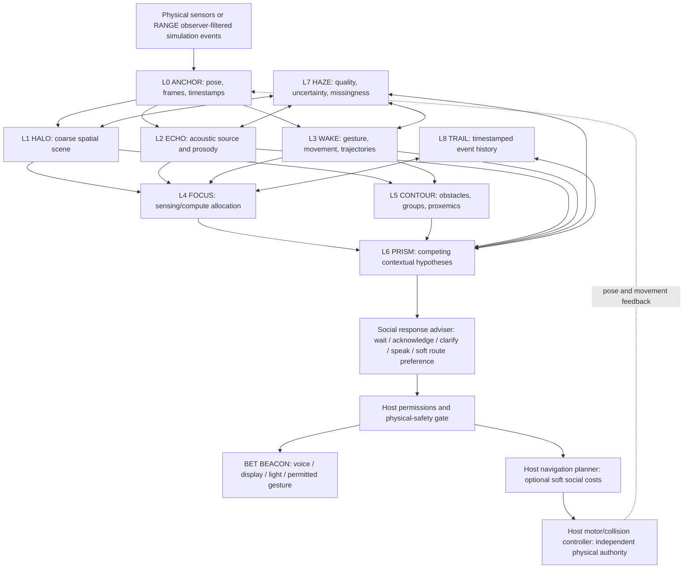
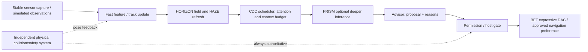

# SOMA HORIZON ΔP — Sensory Layer Architecture & Operational Atlas

**A plain-language and engineering-oriented guide to the L0–L8 sensory horizon**  
**Version:** v0.2 — working research brief, 12 November 2026  
**System family:** SOMA Codec · BET Module · HORIZON ΔP · SOMA RANGE  
**Audience:** first-time readers, AI/robotics collaborators, software developers, research evaluators  
**Status:** conceptual design with prototype recommendations, **not a validated emotion-recognition or robotics performance specification**.


> **In one sentence:** HORIZON is a proposed robot-centered, multimodal situation model that tracks **what happened, where, when, how observations differ from context, which interpretations remain possible, and whether the robot should act, wait, clarify, or respectfully disengage**.

---

## 1. What problem is HORIZON meant to solve?

Most robots can be given instructions such as **“navigate to Booth C,” “answer a question,”** or **“avoid collisions.”** Yet shared human spaces contain interactions that are neither explicit commands nor physical obstacles: someone waiting politely to speak, a queue around a demonstration, playful loudness, indirect gestures, a private conversation that becomes public, or several people addressing the robot at once.

HORIZON investigates whether an embodied agent can handle such situations more appropriately by correlating **spatial, acoustic, visual, kinetic, conversational, and temporal evidence**. Rather than treating every signal independently, it maintains a coherent but uncertainty-aware representation of the immediate scene.

### What HORIZON is—and is not

| HORIZON is intended to be… | HORIZON is **not**… |
|---|---|
| An **egocentric** model: observations expressed relative to a robot's body, time, and surroundings | A literal, fully instrumented 360° vision sphere; uncovered directions remain unknown |
| A **multimodal** evidence-fusion architecture | One universal “emotional pressure” meter |
| A **relative** change detector: compare against appropriate current baselines | A system that can infer character, sincerity, aggression or deception directly from loudness, posture, or facial expression |
| A **contextual** hypothesis and attention-management system | A guaranteed reader of private feelings, motives, disability, or psychological state |
| An **advisory** layer for interaction, navigation preferences and expression | A replacement for the chassis motor, collision-avoidance, or emergency-stop controller |
| An instrument that can be tested with controlled scenarios | A proven performance enhancement before comparison trials establish results |

**The “bubble” in the illustrations is a user-interface metaphor.** The implementation can instead use tracked people/objects, angular bins, a 2.5D occupancy grid, geometric contours, and event histories; the HUD visualizes those underlying representations.

### Why divide the system into nine layers?

A single end-to-end model could receive a scene and output an action. The nine-layer design instead makes specific functions **inspectable, replaceable, measurable and testable**. If the robot misattributes a voice, the researcher can inspect Echo and source association. If it misses a waiting visitor, inspect Wake, Focus, Trail and Prism. If it navigates too close to a conversation, inspect Contour. If it sounds overly certain, inspect Haze and Prism.

The layers are **functional services, not necessarily nine separate programs or hardware boards**. Some run concurrently and send feedback upstream.

---

## 2. System at a glance: observe → align → interpret → advise



**Three different objects must stay separate:** (1) **measurements** such as direction, distance or speech onset; (2) **interpretations** such as *possible request to join a conversation*; and (3) **response proposals** such as *acknowledge at a natural pause*. The host decides whether a requested physical action is permissible and safe.

### Layer classification

| Layer | Short name | Primary role | Nature of output |
|---|---|---|---|
| **L0** | **ANCHOR** | Self-reference and synchronization | Measured/estimated frame, time, body pose |
| **L1** | **HALO** | Coarse spatial awareness | Map of observed/unknown occupancy and event activity |
| **L2** | **ECHO** | Audio and vocal dynamics | Source bearings, speech/acoustic/prosodic features |
| **L3** | **WAKE** | Motion and visible gestures | Tracks, trajectories, gesture events |
| **L4** | **FOCUS** | Attention allocation | Ranked regions/targets and sampling priorities |
| **L5** | **CONTOUR** | Social/physical geometry | Group/queue contours, soft approach preferences |
| **L6** | **PRISM** | Contextual interpretation | Alternative hypotheses with evidence and uncertainties |
| **L7** | **HAZE** | Epistemic quality control | Coverage, missingness, confidence, ambiguity, staleness |
| **L8** | **TRAIL** | Temporal continuity | Event order, duration, changing patterns, memory references |

**BEACON**, the robot's expressive voice/face/ARGB/gesture pathway, is downstream of the nine layers—not a tenth sensing layer. **CDC** is a cross-cutting resource scheduler; the **Relational Ledger** controls what contextual history and information-sharing permissions may be available.

---

## 3. How the layers obtain data: physical equipment versus derived information

Not every layer needs its own sensor. On a real robot, upstream devices collect signals and software creates successive interpretations. In **SOMA RANGE**, the equivalent inputs can initially be synthetic events from the authoritative game world—but the robot must see only events that its simulated sensors could observe.

| Input family | Candidate physical equipment | Primary software methods | Feeds |
|---|---|---|---|
| Self-motion | IMU, wheel odometry, joint encoders, host localization | Pose estimation, kinematic transforms, sensor calibration, timestamps | Anchor, Halo, Wake |
| Wide scene | RGB/fisheye/stereo cameras | Object detection, optical flow, image segmentation, visual tracking | Halo, Wake, Focus, Contour |
| 3D geometry | RGB-D, stereo depth, LiDAR, ultrasonic or proximity sensors | SLAM/occupancy mapping, obstacle extraction, depth projection | Halo, Contour, Anchor |
| Acoustic | Microphone array, synchronized ADC/audio interface | Voice activity detection (VAD), array localization, beamforming, diarization, spectral and pitch analysis | Echo, Focus, Prism |
| Body/gesture | Primarily camera/depth streams; optional tactile sensors | Pose/keypoint estimation, gesture recognition, trajectory tracking | Wake, Focus, Contour |
| Contact | Bumpers, force/contact sensors, encoders, optional tactile surfaces | Contact event extraction and host safety state | Anchor, Wake; physical safety handled separately |
| Context | Current task, permitted dialogue history, venue map, consent/group state | Event router, conversation state machine, contextual retrieval | Focus, Contour, Prism, Trail |
| Quality/coverage | Sensor drivers, calibration monitors, timestamp monitors | Missing-data flags, covariance/quality, occlusion tests, expiry checks | Haze across all layers |

**Sensor rates and inference throughput are device-dependent.** No range in this atlas should be treated as a guaranteed implementation frequency or proof of end-to-end latency.

---

## 4. The nine layers in detail

### L0 — ANCHOR · “Where am I, and what coordinate frame are we using?”

**WHAT:** The robot's own body-centered reference system: pose, orientation, self-motion and clock alignment. It gives all other measurements an origin so an audio bearing, visual track, and floor obstacle can be compared in the same geometry.

**HOW in practice:** The host provides pose and velocity estimates. IMU, odometry, joint encoders and optional camera/LiDAR localization are time-stamped. Software calibrates each sensor's position and orientation relative to the robot, then transforms observations between **sensor-local**, **robot-local**, and **world/map** coordinates. A time-sync service tracks clock offset and stale data.

**What it can quantify:**

- Position `[x,y,z]` in **meters**; heading/orientation in **degrees or radians**.
- Linear speed **m/s**, angular speed **rad/s**, acceleration **m/s²** as available.
- Pose uncertainty or covariance (when estimable), sample age **ms**, clock offset **ms**.
- Sensor mounting transforms and their calibration version.

**WHY:** Without Anchor, a person on the robot's left can appear to switch sides when the robot rotates; a voice direction measured in microphone coordinates can be incorrectly merged with a visual track. Anchor prevents these reference-frame mistakes.

**Typical output:** `robot_pose`, `frame_transform`, `timestamp`, `pose_quality`.  
**Common failure:** wheel slip, drifting localization, poorly calibrated microphone orientation, unsynchronized clocks.  
**RANGE test:** rotate Robot R while a stationary visitor speaks; the world-space visitor should remain stationary even as robot-relative bearing changes.

---

### L1 — HALO · “What's around me at a glance?”

**WHAT:** A coarse, continuously refreshed map of nearby occupancy, free space, broad motion, detected objects and sensor coverage. This is the *outer situational horizon* in the layered-sphere visualization.

**HOW in practice:** Fuse coarse geometry from depth/range, camera detections, map data and spatial activity notices into angular sectors or a sparse spatial grid. Store **occupied / free / unknown** as different states. Maintain anonymous transient object tracks and broad source directions. Aggregate dense observations into cheaper summary bins for efficient peripheral monitoring.

**What it can quantify:**

- Bearing **degrees**, estimated range **meters**, occupancy status/probability if calibrated.
- Object or track counts, free-space connectivity, sector coverage **%**.
- Per-sector activity/salience estimates and observation age **ms**.
- Availability masks for visual, depth and acoustic coverage (not a single imaginary 360° camera).

**WHY:** Detailed interpretation should not require continuously analyzing every pixel, speaker and person at full resolution. Halo helps find *where* more attention may be useful and where navigation may be blocked.

**Typical output:** `spatial_sector_map`, `occupancy_cells`, `coverage_mask`, `coarse_tracks`.  
**Common failure:** treating an unobserved direction as clear; interpreting a heatmap hotspot as danger; stale occupancy after a crowd moves.  
**RANGE test:** cover a camera with a booth wall: the occluded sectors become **UNKNOWN**, not **FREE**.

> The visible spherical Halo represents a **data model**. It does not imply that the robot possesses equally precise sight and hearing in every direction.

---

### L2 — ECHO · “Who or what produced that sound, and how did it unfold?”

**WHAT:** Spatial acoustics, vocal activity and measurable features of speech delivery. Echo supplies **acoustic evidence**, not a direct emotional classification.

**HOW in practice:** A microphone array samples audio through an ADC/audio interface. Voice activity detection marks likely speech onsets and offsets. Time differences of arrival (TDOA), inter-microphone level/phase differences and beamforming estimate acoustic source direction; source separation and audio-visual association may help distinguish speakers. Short windows measure onset/energy, longer windows help estimate pitch contours, spectral patterns and cadence. Optional speech recognition proposes words with its own uncertainty.

**What it can quantify:**

- Voice activity and start/end times **ms**; speech rate **words/min** or syllabic cadence proxies.
- Fundamental frequency F0 **Hz**, pitch contour, pauses **ms**, rhythm and spectral-energy bands.
- Relative digital level **dBFS** or calibrated sound pressure **dB SPL** *only with suitable calibration*.
- Source bearing **degrees**; range **meters** only if genuinely supported; association candidates and confidence/quality.
- Direct/reflected-path ambiguity, signal-to-noise ratio **dB** when defined.

**WHY:** Knowing when someone is speaking, from which direction, and whether the signal is a direct voice or a public-address reflection is essential for turn-taking. Loudness, however, can mean enthusiasm, projection over noise, urgency, anger, performance or microphone proximity.

**Typical output:** `audio_event`, `speaker_candidate[]`, `bearing`, `prosody_features`, `source_ambiguity`.  
**Common failure:** reverberation, overlapping speakers, loudspeaker voices, echo, robot self-noise, assigning speech to a silent nearby visitor.  
**RANGE test:** place a loud speaker behind a reflective booth; see whether Echo avoids confidently blaming a nearby silent avatar.

**Example distinction:** `speech_detected=true` may be an observation; `speaker=Visitor_X` may be an estimate; `Visitor_X_is_angry` is **not** established by loud audio.

---

### L3 — WAKE · “How are people and objects moving?”

**WHAT:** Body pose, movement trajectories, visible gestures and their changes over time. A *wake* is the trace left by motion—approaching, turning, pointing, waving, waiting or departing.

**HOW in practice:** Cameras and optional depth sensing yield anonymous body/keypoint tracks, optical flow and object motion. Across timestamped frames, a tracker estimates velocity, heading, relative approach, gesture shape and persistence. WAKE can fuse host movement to distinguish the robot's own motion from the movement of the observed person.

**What it can quantify:**

- Position and trajectory in **meters**; speed **m/s**, acceleration **m/s²**, relative approach speed **m/s**.
- Joint/keypoint coordinates, body/face orientation **degrees**, angular velocity.
- Gesture events such as `RAISED_HAND`, `POINT`, `WAVE` with onset, duration and estimated target.
- Track continuity and observation quality; motion history in **seconds**.

**WHY:** A polite conversational bid might not contain speech. A person could pause nearby, orient toward the robot and briefly raise a hand. WAKE supplies evidence that can prompt a low-pressure invitation later—without deciding the person's true intentions.

**Typical output:** `kinetic_track`, `trajectory`, `gesture_event`, `motion_quality`.  
**Common failure:** occluded hands, unusual gait, adaptive devices/wheelchairs, different gesture conventions, movement caused by camera motion, mistaken identity across crossing tracks.  
**RANGE test:** distinguish a passerby from someone repeatedly orienting toward the current conversation while remaining at approximately the same distance.

**Interpretation boundary:** posture or gait does not certify personality, emotional condition, disability, aggressiveness or trustworthiness.

---

### L4 — FOCUS · “Where should limited attention and compute go next?”

**WHAT:** An adaptive **attention-resource controller**, not a new physical sensor. Focus decides which people, objects, directions and events deserve higher-resolution observation or closer contextual checking.

**HOW in practice:** Rank candidate targets using task relevance, direct address, event novelty, unresolved uncertainty, recent interaction, proximity and safety-adjacent observational needs. Request narrower camera crops, higher-frequency tracking, richer acoustic/source analysis or a more detailed PRISM pass for selected targets. Preserve a low-resolution peripheral scan so the system does not tunnel-vision on the current speaker.

**What it can quantify:**

- Ranked target IDs, attention allocation **% of configured budget**, region bearing/width **degrees**.
- Last inspection age **ms**, time-on-target **s**, active-speaker status.
- Focus-switch count/rate and selection-reason codes.

**WHY:** A robot at an expo cannot run the most expensive vision, audio and LLM reasoning on everyone simultaneously. Focus spends limited compute where it may improve the immediate task and avoids dropping awareness of nearby developments.

**Typical output:** `attention_targets[]`, `focus_lobes[]`, `resource_request`, `focus_reason`.  
**Common failure:** locking onto the loudest person, starving quiet participants, oscillating between two people, starving peripheral monitoring.  
**RANGE test:** continue following Person X's speech while allocating intermittent observation to Visitor Y's nonverbal bid and ignoring an unrelated demonstration unless it becomes relevant.

**Important:** High salience means **attention candidate**, not “person of concern.” Focus may be a scheduler inside the runtime rather than a separate neural network.

---

### L5 — CONTOUR · “How is this space socially organized?”

**WHAT:** Physical and *soft social* geometry: obstacles, queues, conversational groups, pedestrian flow, approach corridors, waiting distances and crowd-sensitive boundaries. The social contours can stretch and deform with orientation, movement and context.

**HOW in practice:** Use Halo occupancy, Wake trajectories, depth/range and group/turn-taking cues to form transient clusters. Estimate a conversation group from proximity, mutual orientation and ongoing interaction. Construct **soft** spatial cost fields around occupied positions, between conversation participants and across queues; send these only as navigation **preferences** to the host planner.

**What it can quantify:**

- Interpersonal spacing **meters**, group size, estimated queue geometry and lane widths **meters**.
- Relative heading and predicted crossing paths; time-to-proximity **seconds** as a rough forecast.
- Anisotropic spatial cost (a **dimensionless planning penalty**, not emotional pressure), source/expiry and uncertainty.
- Route deviation, crowd intrusions and clearance metrics for evaluation.

**WHY:** A collision-free route can still be rude: cutting through an active conversation or crossing the front of a queue. Contour can propose a slightly longer, less intrusive path—or a stop-and-wait when no suitable route exists.

**Typical output:** `group_contours`, `queue_segments`, `social_cost_grid`, `approach_pose_candidates`.  
**Common failure:** treating every group as a permanent barrier, inferring universal personal-space radii, confusing incidental proximity with a friendship group, blocking the robot from approaching someone who requested assistance.  
**RANGE test:** compare paths through a busy expo: baseline collision-only routing versus geometry-aware social routing, while monitoring deadlocks and task completion.

**Physical authority:** the host's collision constraints remain hard. A social-cost preference cannot authorize passing through a human, wall or inaccessible path.

---

### L6 — PRISM · “What are the plausible explanations for what we observed?”

**WHAT:** A context-and-hypothesis service. PRISM does not “detect intent” as a physical sensor detects distance; it assembles **alternative explanations** using observations, current objectives, dialogue, available history and situational constraints.

**HOW in practice:** Gather evidence records from Echo, Wake, Halo/Contour, relevant task history and current conversation state. Propose a small, bounded candidate set—e.g., `REQUESTING_HELP`, `WATCHING_DEMO`, `WAITING_FOR_FRIEND`, `UNKNOWN`—and retain supporting and conflicting evidence. A rules engine may be sufficient for simple situations; an LLM can offer interpretations for complex dialogue, but its output remains a proposal with provenance and validation checks.

**What it can quantify or record:**

- Evidence references, source/recency and hypothesis labels.
- Whether a hypothesis is `COMMIT`, `LEAN`, or `HELD_OPEN` under a documented policy.
- If calibrated experimentally, probabilities or rank scores with validation data; **uncalibrated numbers must not masquerade as objective probabilities**.
- Candidate next actions, cost of interruption, and whether clarification is necessary.

**WHY:** The same observed cues can mean different things. Loud voices at a product demo may be performance, celebration, urgency or disagreement. Someone standing quietly to the side may wish to join a discussion—or may be waiting for someone else. PRISM helps the robot avoid treating its first interpretation as truth.

**Typical output:** `hypotheses[]`, `evidence_refs[]`, `alternatives`, `read_status`.  
**Common failure:** overconfident intent labels, hidden simulator-ground-truth leakage, mapping cross-modal incongruence to “dishonesty,” excessively long reasoning that misses the conversational window.  
**RANGE test:** keep the same observed raised-hand gesture while changing hidden NPC objectives; evaluate whether the robot makes appropriately reversible, low-pressure responses rather than asserting what the person wants.

**Scope restriction:** PRISM may infer **possible communicative purpose** for choosing a respectful response. It must not claim to diagnose emotions, sincerity, psychological state or dangerousness.

---

### L7 — HAZE · “What don't we know, and how reliable is this reading?”

**WHAT:** A cross-cutting **uncertainty and missing-data** service. Haze annotates every relevant layer; it is not simply a final confidence score attached after the fact.

**HOW in practice:** Track sensor-health status, coverage sectors, camera occlusion, acoustic reflections, track age, synchronization errors, conflicting source assignments, inferred versus observed quantities and uncalibrated model outputs. Compute quality where meaningful and preserve validity categories such as `OBSERVED`, `DEGRADED`, `OCCLUDED`, `MISSING`, `EXPIRED`, `UNKNOWN_SOURCE`.

**What it can quantify:**

- Observation age **ms**; dropped-frame counts; coverage **%**.
- Position covariance or localization uncertainty; feature quality **0–1** as a configured score.
- Presence of contradictory source assignments and evidence coverage.
- Explicit unknown/expired masks—never silently convert them to zero activity.

**WHY:** A system that reports “nothing happening” when a camera is blocked can make worse decisions than one that openly says “I cannot currently see.” Haze prevents missing observations from being interpreted as a calm room and discourages unsupported certainty.

**Typical output:** `quality_mask`, `validity`, `sensor_health`, `uncertainty_notes`, `needs_recheck`.  
**Common failure:** inventing certainty from heatmap color, treating 0 quality as 0 activity, using one confidence score for incompatible modalities, ignoring stale data.  
**RANGE test:** remove camera coverage mid-conversation; the robot should not claim that the visitor left, nor should it hallucinate visual gestures.

**Design rule:** Haze should influence whether PRISM **commits**, **leans**, **asks**, or **abstains**—without independently classifying people as risky.

---

### L8 — TRAIL · “How did this situation develop over time?”

**WHAT:** Time history, change persistence, event order and memory pointers. Trail stores how the scene evolved rather than repeatedly treating each frame as a brand-new situation.

**HOW in practice:** Maintain time-stamped short rolling buffers for observations/tracks and an event log for significant changes. Apply decay or expiry to transient evidence. Store durable task commitments in the appropriate authorized memory service instead of letting the short sensor buffer erase them. When summarizing, retain provenance to original events for diagnostic replay.

**What it can quantify:**

- Event onset/offset **s**, duration **s**, interval since last seen **s**.
- Persistence across multiple samples, change rate, order of speakers and turn-boundary events.
- Context-relative trends, including repeated attention cues or sustained congestion.
- History depth, event expiry and sampling gaps.

**WHY:** One glance can be accidental; several approaches toward the robot plus repeated waiting can justify a more careful observation. A brief loud laugh differs from a sustained dispute. Trail supplies the trajectory of events that a still frame cannot provide.

**Typical output:** `recent_events[]`, `track_history`, `temporal_features`, `event_refs`.  
**Common failure:** accumulating massive context windows, treating old events as current, retaining public bystander profiles unnecessarily, using an old guess as if it were an observation.  
**RANGE test:** compare a visitor walking past with one who returns repeatedly and attempts a short wave; check whether the robot's behavior changes appropriately without assuming motives.

**Privacy baseline:** short-lived public tracks should expire unless a specific authorized research or interaction purpose justifies keeping them. Longer-lived relational memory is governed by separate scope and consent rules.

---

## 5. How do nine layers become one useful “macro” reading?

**Not by summing all sensor outputs into a single emotion number.** The intended macro product is an **evidence-grounded scene state**: a set of entities, observations, time relationships, possible interpretations, missing information, and safe response options.

### Step A — Establish where and when

Anchor transforms each incoming event into a common reference and time domain. If it cannot align sources reliably, Haze marks the association uncertain.

### Step B — Maintain “who/what/where” without pretending to know “why”

Halo builds coarse occupancy; Echo and Wake supply audio/kinetic features; source association links or leaves open which features belong to which anonymous track. Contour adds group/queue spatial relationships. Focus chooses which evidence is worth refreshing.

### Step C — Calculate **context-relative ΔP**, where meaningful

ΔP is a **metaphor for a normalized deviation**, not a physical pressure or measured feeling. For a valid numeric channel `k` associated with track `i`:

\[
 z_{i,k}(t) = \operatorname{clip}\left( \frac{x_{i,k}(t)-b_{i,k}(c,t)}{\max(s_{i,k}(c,t),\epsilon)}, -M_k, +M_k \right)
\]

- `x` is an observed quantity, with units, origin and timestamp.
- `b` is a context-specific baseline (environment, current session, or appropriately consented source history).
- `s` is a robust scale estimate or declared fallback **in the same units**; `M` clips outliers.
- `q` (signal quality), `validity`, `coverage`, `observed_at`, and `source` are **separate fields**.
- If evidence is missing or its baseline is unsupported, store `z = null` with a reason—**not 0**.
- Categorical events such as `RAISED_HAND` are event records, not forcibly normalized numeric channels.

Examples of valid ΔP interpretations: “this speaker's loudness is **higher than their session reference**,” or “approach speed has **increased relative to recent motion**.” Neither one by itself means aggression, anxiety, interest, sincerity, or danger.

### Step D — Optional salience summary, with explicit coverage

For **attention scheduling only**, a candidate weighted activity summary is:

\[
 S_i(t) = \sqrt{\frac{\sum_{k \in V} w_k q_k z_{i,k}(t)^2}{\sum_{k \in V}w_k q_k}}, \qquad
 Q_i(t) = \frac{\sum_{k \in V}w_k q_k}{\sum_{k\in K} w_k}
\]

Here `V` is the set of **valid** features and `K` is the set expected in the configuration; `w` are documented weights. If the activity denominator is zero, `S = null`. `Q` reports evidential coverage/quality. The score is not comparable across changed sensor configurations without calibration; it is **not a universal emotional-intensity index**.

**Prefer the typed vector and event flags** over this summary for actual dialogue or navigation decisions.

### Step E — Context produces candidate meanings

PRISM combines the observed evidence with scene/task/conversation context, while Haze adds alternative source possibilities and incomplete coverage; Trail supplies onset, persistence and sequence. The result might be:

| Observable evidence | Plausible readings | Appropriate uncertainty |
|---|---|---|
| Person faces Robot R, remains nearby and briefly raises hand | May wish to speak; may be signaling a friend; may be attending a demo | `HELD_OPEN` without explicit address |
| Very loud nearby speech + large gestures | Product demonstration; performance; upset disagreement; urgent warning | Depends on words, sources, motion and setting |
| Several people standing in a rough circle | Conversation group, queue spillover, audience cluster | Group boundary provisional |
| Speech heard but no matching visual mouth motion | Off-camera speaker, reflection, loudspeaker, occluded person | Source association unresolved |

### Step F — Produce an **advisory**, not an unbounded command

The output is something like: *continue listening to X; monitor Y; do not infer hostility from Z; optionally acknowledge Y at a conversational boundary; preserve safe navigation clearance.* The host then validates permitted behavior and physical feasibility; BET Beacon handles expression only after approval.

### Spatial interpretation: the adaptive field

A practical implementation need not maintain a full 3D voxel field at high resolution. A hybrid can be more efficient:

1. **Coarse angular/radial Halo** for coverage and broad activity.
2. **Ephemeral tracked entities** for people, objects and active acoustic sources.
3. **Local depth/occupancy or navigation grid** for collision geometry.
4. **Soft anisotropic contours** near people, queues and conversational groups.
5. **Attention lobes and event timelines** rendered on demand in the operator HUD.

A sample social preference field for one tracked person is an anisotropic Gaussian:

\[
 C_i(x) = a_i\exp\left[-\tfrac12(x-p_i)^T\Sigma_i^{-1}(x-p_i)\right]
\]

This yields a **soft planning cost** based on position/orientation and context—not a “hostility field.” The host planner optimizes only among independently feasible trajectories. A loud exhibitor does not automatically create a forbidden zone; a quiet person on a collision course still requires ordinary host safety handling.

---

## 6. Worked example — Robot R at a convention expo

**Setup:** Robot R is answering **Visitor X**. **Visitor Y** stands slightly to the robot's side, waiting quietly. **Exhibitor Z** starts a loud, theatrical product demonstration. The robot's current task is to help people without rudely interrupting active conversations.

| Stage / layer | What the system can observe or derive | What it must **not** assume |
|---|---|---|
| **L0 Anchor** | R's pose and sensor frames; X/Y/Z positions relative to R | Those positions alone establish relationships |
| **L1 Halo** | Three nearby tracks, booths, crowded corridor and sensor coverage | 360° picture means no blind spots |
| **L2 Echo** | X has an active speech turn; strong audio activity appears near Z | High volume = hostility; visible Y is the voice source |
| **L3 Wake** | Y stops nearby, intermittently turns toward R, briefly lifts a hand | Y definitely wants help or is “shy” |
| **L4 Focus** | Primary lobe stays on X, secondary short checks monitor Y; Z remains background unless relevant | The loudest actor must win priority |
| **L5 Contour** | X/R form a local conversational space; Y is near its edge; an expo queue blocks one route | Group boundaries are universal or permanent |
| **L6 Prism** | `Y_MAY_WANT_TURN`, `Y_WATCHING_DEMO`, `Y_WAITING_FOR_OTHER` all remain plausible; Z may be performing | The first interpretation is certain |
| **L7 Haze** | Y's gestures partially occluded; speaker Z may be reflecting off a wall | Missing evidence indicates nothing happened |
| **L8 Trail** | Y has remained for several seconds; X is nearing a turn boundary; Z's loudness is brief | A single moment captures the full interaction |

**Possible response:** R finishes X's current question, turns slightly toward the shared space or says, *“If you needed something, I can help after this.”* If Y indicates they were not addressing R, R returns to its task without embarrassment or a persistent profile label.

**Different possible outcome:** A sudden collision risk arises while the robot is engaged. The **host safety loop** brakes or stops without waiting for Prism, an LLM or a social interpretation.

**Why this scenario matters:** it tests whether combined **where + how + when + context + uncertainty** is better than a model receiving only raw position and dialogue text. A correct outcome need not include engagement: appropriate **waiting, non-interruption, abstention and repair** are valid successes.

---

## 7. A canonical data contract for implementing the layers

The following is a **proposed, illustrative** schema; values are synthetic, not measured performance:

```yaml
schema: horizon.observation.v0.2
observation_id: obs_00421
sim_or_monotonic_ms: 94120
source_track: ephemeral_visitor_07
frame: robot_local_xyz
sensor_sources: [camera_front, depth_front, mic_array]

geometry:
  bearing_deg: 47.0
  position_m: {x: 1.4, y: 1.1, z: 0.0}
  range_status: ESTIMATED
  position_uncertainty_m: 0.3

observed:
  voice_active: false
  head_orientation_deg: 28.0
  approach_velocity_m_s: 0.0
  gesture_event: RAISED_HAND_BRIEF

relative_features:
  head_orientation_change:
    z: 1.2
    baseline_scope: SESSION
    quality: 0.7
    validity: DEGRADED
  vocal_intensity:
    z: null
    baseline_scope: NONE
    quality: 0.0
    validity: MISSING

source_association:
  candidate_track_ids: [ephemeral_visitor_07]
  status: PROVISIONAL

interpretation:
  hypotheses:
    - {id: MAY_REQUEST_TURN, read: HELD_OPEN, evidence: [obs_00419, obs_00421]}
    - {id: WATCHING_EXHIBIT, read: HELD_OPEN, evidence: [scene_expo]}
  confidence_calibrated: false

advisory:
  option: ACKNOWLEDGE_AT_TURN_BOUNDARY
  alternatives: [WAIT, NO_OP]
  expires_in_ms: 500
  navigation_preference_only: true
  requires_host_gate: true

privacy:
  scope: PUBLIC_EPHEMERAL
  persistent_person_profile: false
```

### Interface rules

- **Every observation** needs a timestamp, reference frame, modality/provenance, validity and expiry or freshness policy.
- **Every inferred field** must say it is inferred; an LLM-generated explanation cannot be written back as a physical observation.
- **Every hypothesis** should refer to supporting evidence, allow alternatives and expire or be revised after contradiction.
- **Every expression or motion proposal** needs an approved target, channel, scope, TTL and host acceptance/rejection record.
- **All synthetic NPC private goals** remain evaluator-only; they are *never* passed to Robot R simply because the simulation engine stores them.

---

## 8. Runtime coordination, compute budgets and CDC

HORIZON runs across different compute time scales. High-level LLM interpretation should never hold up physics or emergency handling.



### Candidate scheduling design—not promised rates

| Lane | How it should operate | Prototype idea / validation need |
|---|---|---|
| **Host safety/physics** | Independent engine/controller loop; never blocks on the LLM | Use host's supported deterministic tick and verify stopping behavior |
| **Sensor capture** | Stable drivers and ring buffers, timestamped independently | Measure device jitter and lost samples; avoid disruptive reconfiguration |
| **Feature extraction** | Short windows/onsets plus larger overlapping windows where required | Profile channel-specific update cadence, e.g. configurable 5–20 Hz fused refresh as a **starting experiment** |
| **L0/L1/L2/L3 tracking** | Asynchronous frequent updates; drop/expire stale work | Benchmark p50/p95 latency, frame loss and CPU/GPU load |
| **L4/L5/L7 coordination** | Lightweight event- or interval-driven updates | Bound cost of group recomputation and focus switching |
| **L6 PRISM / LLM** | Invoke on task-relevant changes, ambiguous turns or requests | Seconds-scale responses may occur; use queue deadlines and fallback to WAIT |
| **L8 TRAIL / memory** | Cheap rolling event history; occasional compact summaries | Limit context and retention; preserve traceability for replay |

**CDC is a compute/resource policy, not the robot's physical safety controller.** The original CDC proposals include `IDLE`, `STANDARD`, `COOPERATIVE`, `ALERT`, `SOVEREIGNTY DEFENSE`, `EMERGENCY`. For the first RANGE beta, a smaller implementation palette such as `IDLE / STANDARD / FOCUSED / ALERT_CONTEXT / EMERGENCY_HOST_ONLY` may be easier to test, with explicit mapping to the original terminology.

Mode changes can apply hysteresis, minimum dwell times and cooldowns for **noncritical** context. Physical emergency intervention has no social hysteresis delay. High sound intensity may warrant extra acoustic attention, not automatically a threat mode. MIDI-style control is an optional *low-bandwidth expressive parameter interface*, **not** the transport for raw audio nor a promise of zero-latency device reconfiguration.

### Software partition in a first SOMA RANGE prototype

| Component | Suggested owner | Reason |
|---|---|---|
| Simulated world, true positions, physics, line-of-sight, navmesh | **Godot 4 / GDScript** | One authoritative world and deterministic collision handling |
| Observer-filtered synthetic visual/acoustic events | **Godot adapter** | Prevent evaluator truth from leaking to an agent |
| Typed packets, ΔP, Haze, Trail, Prism, agent scheduling | **Python sidecar** | Testable algorithms, logging, LLM provider independence |
| Optional 2.5D social cost field | **Python reference**, rendered/consumed by Godot host | Compare against baseline navigation; host keeps hard limits |
| HALO/HUD debug renderer | **Godot** | Visualize actual sensor and inference data, not invented diagnostics |
| Bet/Beacon expressive mapping | **Typed control API**; optional MIDI adapter | Chassis-agnostic face/light/voice mapping and bounded output |
| Experiment evaluator | **Python + SQLite/JSONL** | Paired A/B trials, replay, provenance and quantitative reporting |

A later physical robot can replace synthetic streams with actual cameras/mics/odometry and connect host-approved social preferences to a robotics navigation stack. **That replacement requires separate calibration, hardware validation and privacy/consent review.**

---

## 9. The diagnostic Halo HUD: what its colors and shapes mean

The visual atlas assigns a different aesthetic/color identity to each service, but a real HUD should distinguish **activity**, **source**, **confidence**, and **meaning** rather than mixing them into one gradient.

| UI element | Encode | Do **not** imply |
|---|---|---|
| Blue coarse spherical cells | Coarse coverage/occupancy/activity map | Complete or equally good 360° sensing |
| Acoustic waves | Audible activity and estimated source bearing | Emotional valence or identity certainty |
| Motion arrows / trails | Observed or predicted movement | Intent or dangerousness |
| Yellow focus cones | Where extra computation is allocated | Suspicion, priority of a person's worth |
| Green group contours | Provisional conversational/queue geography | Exact or universally valid personal-space boundary |
| Cyan branching hypotheses | Alternative contextual interpretations | That the highest-scored interpretation is proven |
| Violet hatching/clouds | Missingness, disagreement, ambiguity | An emotion hidden in the person |
| Fading time bands | Recent event persistence and decay | Indefinite social memory |

Use labels such as **OBSERVED**, **ESTIMATED**, **HYPOTHESIS**, **UNKNOWN**, **EXPIRED**. Textures/hatching should supplement color for accessibility. The robot's **public Beacon palette is independent** of the private operator HUD: an amber diagnostic hotspot should not automatically turn the robot's face or light amber.

---

## 10. Privacy, responsible inference and control authority

1. **Public bystanders are anonymous by default.** Use ephemeral tracks; no opt-out-defying face recognition or persistent personality profiles.
2. **Private dialogue stays scoped to authorized participants.** Changing who is in earshot can require the robot to narrow or pause sensitive speech.
3. **No mind-reading or lie detection.** Cross-modal “coherence” may help determine source/time consistency, not sincerity. Quiet nonparticipation must remain valid.
4. **No covert behavioral manipulation.** Do not probe boundaries or optimize strangers' engagement through automated escalating humor or teasing.
5. **Respect sensor failure.** Inability to observe does not justify an invented event or confident inference.
6. **Action proposals can be refused.** BET/HORIZON may advise a softer route, a glance, a pause, or a voice register; only the robot host controls physically authorized locomotion and collision safety.
7. **Separate research labels from robot observations.** An NPC's authored goal or the evaluator's scenario answer exists only for scoring until legitimately observed or disclosed.
8. **Record what was actually shown to the agent.** Save observation packets, source timestamps, model/prompt versions, actions, and host rejections for transparent comparison.

---

## 11. How to test whether the nine-layer design actually helps

The proposed mechanism is not proven because it looks compelling in an infographic. **SOMA RANGE** can provide reproducible comparisons between simpler and richer perception representations.

| Test arm | Added capability | Principal question |
|---|---|---|
| A0 | Basic valid observations + same action interface | What can the baseline agent already do? |
| A1 | L0 + L1 + L2 + L3 structured spatial/audio/motion packets | Does structure improve source and event handling? |
| A2 | Typed context-relative ΔP with coverage/quality flags | Do relative changes improve attention without false alarm? |
| A3 | L7 Haze + L8 Trail | Do uncertainty and temporal history reduce attribution errors? |
| A4 | L4 Focus + L6 Prism alternatives | Do turn-taking and error repair improve at acceptable inference cost? |
| A5 | L5 Contour soft social navigation | Does routing avoid conversation/queue intrusion without deadlocks? |
| A6 | Context-sensitive Beacon expression | Are responses more appropriate without being invasive? |

**Controls:** same model family, permitted observation information, action vocabulary, scenario initialization and scoring rules where feasible; report token differences and stochastic variability. Use **paired isolated worlds**, not two experimental robots influencing each other's comparison conditions. Keep logged intervention runs separate from controlled trials.

**Suggested measurements:** source attribution accuracy, false interruption, missed conversational bids, appropriate abstention, task completion, path intrusion, collision/clearance, deadlock, hypothesis calibration when available, human-rated appropriateness, correction quality, p50/p95 response latency, peak memory, CPU/GPU use, dropped observations, privacy violations and host-rejected requests.

**Critical failure scenarios:** loud playful argument versus real physical hazard; PA echo behind a wall; side visitor who is only watching; unseen/occluded gesture; narrow aisle with an active queue; a user explicitly declining interaction; model-generated interpretation that contradicts the actual sensory record; private conversation interrupted by a public audience.

---

## 12. Glossary for new readers

| Term | Meaning |
|---|---|
| **SOMA Codec** | The wider proposed multimodal communication/perception/expression research architecture |
| **BET** | The proposed mountable behavioral sensing, advisory and expression module |
| **HORIZON ΔP** | The proposed context-relative, spatially situated multimodal perception subsystem |
| **Halo** | The coarse awareness field **and** its diagnostic display metaphor; context should clarify which |
| **Anchor** | Robot reference frame, self-motion and time alignment |
| **ΔP** | A typed, normalized change relative to an appropriate baseline—not pascals and not “emotion pressure” |
| **Prism** | Competing contextual explanations, not direct emotional mind-reading |
| **Haze** | Explicit uncertainty, missingness, degraded sensing and competing source assignments |
| **Trail** | Short temporal history and event continuity, with privacy-aware retention |
| **CDC** | Contextual Directive Core / resource-and-mode scheduling architecture |
| **Beacon** | Separate outward expressive path: voice, face, ARGB, permitted gesture/haptics |
| **Relational Ledger** | Permissioned contextual/relational history and disclosure rules, not a person-value rating |
| **SOMA RANGE** | The proposed multi-agent simulation/testing environment for benchmarking HORIZON |

---

## 13. Source lineage, version precedence and research status

**Project concepts synthesized:**

- `SOMA_HORIZON_DeltaP_Concept_Spec_v0.1.md` — original nine-layer Halo vocabulary, geometry, public/private behavior, scenarios and staged tests.
- `SOMA_HORIZON_DeltaP_Math_Control_Addendum_v0.2.md` — revised typed ΔP math; separation of validity from signal magnitude; source consistency versus sincerity; advisory cost fields; compute and host-safety separation. **This newer addendum takes precedence where old equations conflict.**
- `SOMA_RANGE_Master_Build_Blueprint_v1.0.md` — simulation ownership, synthetic observer filtering, agent/communication contracts and A/B experiments.
- `CDC_MODE_SWITCHING_ARCHITECTURE_v0.1.md`, `SOCIAL_GEOMETRY_ENGINE_v0.1.md`, `RELATIONAL_LEDGER_SPEC_v0.1.md`, `SOMA Codec — Situational Tier Protocols v0.1.md`, `SOMA Codec — Chatbot Tier Expression Spec v0.5.md` — concept origins and social/epistemic constraints.
- Attached **SOMA HORIZON — Sensory Layer Atlas Concept 01** — intended visual vocabulary and L0–L8 naming; diagnostic numbers appearing in concept art are illustrative, **not live readings**.

**Added engineering suggestions in this atlas:** candidate per-layer metrics, output contracts, test cases, software partition, and implementation examples. Those proposals have **not** been calibrated against physical sensor data or shown to improve human-robot interaction. A physical deployment requires separate safety validation, privacy review, sensor calibration, realistic latency profiling and human-subject evaluation.

> **Final premise:** HORIZON should not tell a robot **“this person feels X.”** It should allow the robot to say, internally, **“I observed A and B, I may be missing C, D and E are plausible interpretations, and the least intrusive useful next step appears to be F—subject to permission and host safety.”**

**SOMA HORIZON ΔP · Perceive → Align → Compare → Contextualize → Hold uncertainty → Advise → Convey.**
